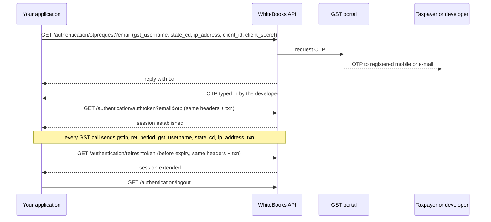
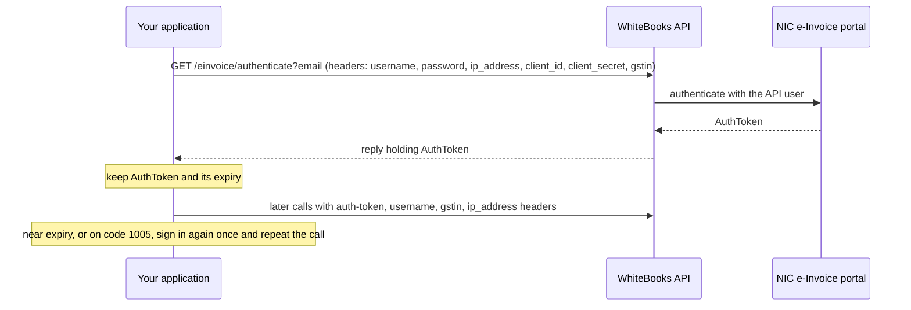

# Authentication flows

How the three logins work, as the clients implement them. Operation ids are those of `operations-<area>.json`. Sources:
the WhiteBooks API specification and WhiteBooks' published e-Invoice API flow. The
behaviour a client must have is in `client-contract.md` (CC-2 to CC-6).

Every call carries `client_id` and `client_secret` headers and the `email` query parameter. Each area has its own pair: `WB_GST_CLIENT_ID`/`WB_GST_CLIENT_SECRET` for GST and the public operations, `WB_EINV_CLIENT_ID`/`WB_EINV_CLIENT_SECRET` for e-Invoice, `WB_EWB_CLIENT_ID`/`WB_EWB_CLIENT_SECRET` for e-Way Bill. Never
put those values in code; read them from the environment (`client-contract.md`, section 1).

## 1. GST returns (OTP)

Operation ids: `gst:GET:/authentication/otprequest`, `gst:GET:/authentication/authtoken`,
`gst:GET:/authentication/refreshtoken`, `gst:GET:/authentication/logout`. The spec also has `gst:GET:/authentication/otpforevc`, the OTP request for signing with an EVC; the clients do
not use it in the session.



Notes.
- The client never reads or guesses the OTP; the developer or taxpayer supplies it.
- `ip_address` is the same for the whole session (`client-contract.md`, section 3).
- Token lifetime: the official e-Invoice flow gives 1 hour in the sandbox and 6 hours in production, and the e-Invoice session follows it. GST and e-Way Bill document none, so the client assumes 6 hours. All refresh 5 minutes early.
- The taxpayer must have enabled "Manage API Access" on the GST portal for this GSP-ASP pair. When it is off or
  revoked, `otprequest` or later calls fail and retrying will not help; the taxpayer has to enable it, and the client
  then starts a new session. The error entry is described in `errors.md`.

## 2. e-Invoice

Operation id: `einvoice:GET:/einvoice/authenticate`.



Notes.
- `username` and `password` here are headers. Concurrent sign-ins share one in-flight request.
- The credentials are the NIC e-Invoice API user for the area's own GSTIN (`WB_EINV_GSTIN`, `WB_EINV_NIC_USERNAME`, `WB_EINV_NIC_PASSWORD`; the e-Way Bill area has `WB_EWB_*` equivalents), not the GST portal user.

## 3. e-Way Bill

Operation id: `ewaybill:GET:/ewaybillapi/v1.03/authenticate`.

```mermaid
sequenceDiagram
    participant App as Your application
    participant WB as WhiteBooks API
    participant EWB as NIC e-Way Bill portal
    App->>WB: GET /ewaybillapi/v1.03/authenticate?email&username&password (headers: ip_address, client_id, client_secret, gstin)
    WB->>EWB: authenticate with the API user
    EWB-->>WB: session established
    WB-->>App: success
    Note over App: record the expiry only; no token is kept
    App->>WB: later calls with ip_address, client_id, client_secret, gstin headers
    Note over App: near expiry, or on code 1005, sign in again once and repeat the call
```

Notes.
- Unlike e-Invoice, `username` and `password` travel in the query string and the client keeps no token. Keep the full
  request URL out of logs, because it contains the password.
- The spec also lists an optional `irp` query parameter (`NIC1` or `NIC2`). The clients do not send it; add it
  to the login call if your account needs a specific portal.

## 4. Public operations

The `public` tag operations (for example `/public/search`) need no session; they take the GST `client_id`, `client_secret` (`WB_GST_CLIENT_ID`, `WB_GST_CLIENT_SECRET`), `email`
and, for some, `ip_address` from the configuration.
